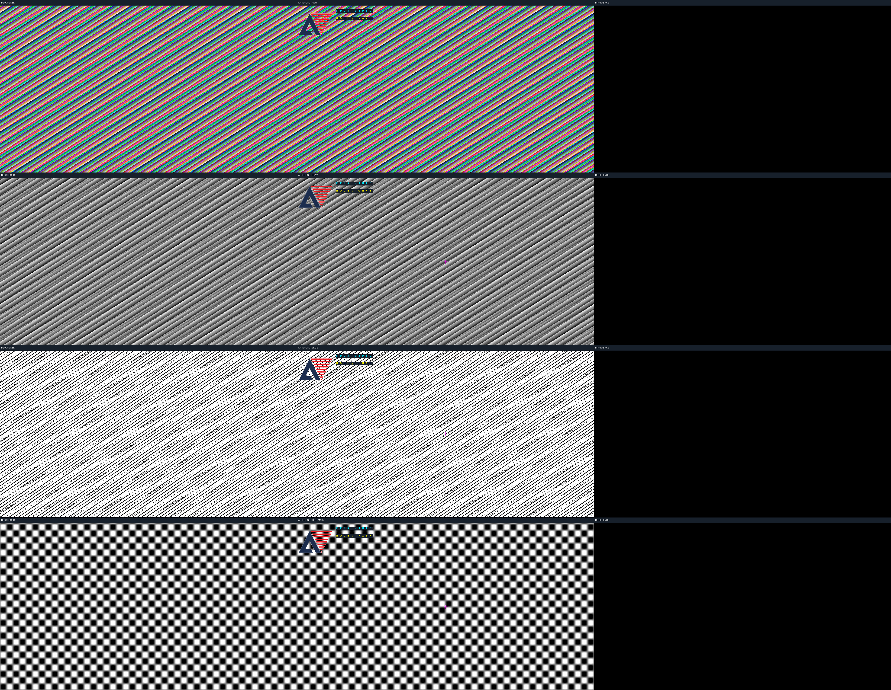

# FPGA 图像处理与静态 OSD · B7

RGB888 视频流支持原图、灰度、Sobel 边缘和测试掩膜四种显示模式；按键请求在帧边界切换，输出叠加安路 Logo、固定标题、模式标签和中心十字。

本仓库是 B7 阶段交付候选，包含 B6 核心功能。小图、720p 仿真及独立综合已有通过记录；尚未接入真实识别结果、动态目标显示或完整 HDMI 板级工程，没有 bit 文件。人员分工按图像处理职责对应，B7 是验收阶段编号。



## 目录

```text
├── README.md          # 从这里开始
├── run.py             # 统一检查入口
├── rtl_sources.f      # 18 个功能 RTL 的相对路径清单
├── requirements.txt   # Python 依赖
├── .gitignore         # 排除仿真、综合产物和本机环境
├── rtl/               # 16 个自编写功能模块，顶层 video_display
├── sim/               # 3 个 testbench：素材、独立 OSD、联合显示
├── model/             # 独立 Python 参考计算与逐像素比较
├── scripts/           # ModelSim 自动运行和路径管理
├── synthesis/         # TD 综合脚本、约束、探针顶层及告警核查
├── assets/osd/        # 官方 Logo、字模、冻结参考及来源记录
├── docs/              # 接口、交接、运行说明及两张结果预览
└── reports/           # 精选历史证据、来源映射及本次整理验证
```

## 运行

使用 Windows、Python（NumPy、Pillow）、ModelSim 和可选的 TD。已验证工具版本：Python 3.14.6、ModelSim Altera Starter 10.3c、TD 6.2.168116。其他平台未验证。

在本 README 所在目录打开 PowerShell；使用已安装依赖的 Python。新环境可先执行 `python -m pip install -r requirements.txt`。

```powershell
python .\run.py --modelsim 'D:\altera14.1\modelsim_ase\win32aloem'
```

将 ModelSim 路径换成实际安装目录。默认先核对源码清单，再运行素材读回、独立 OSD 五组小图和联合显示三组小图，包含错误注入检查。最后应出现：

```text
PASS: B7 GitHub project checks completed.
```

大图验证及综合可按需单独运行：

```powershell
python .\run.py --720p --modelsim 'D:\altera14.1\modelsim_ase\win32aloem'
python .\run.py --synthesis-only --td 'D:\TD\bin\td_commands_prompt.exe'
```

`--720p` 检查独立五背景和联合十帧；`--synthesis` 可在默认仿真后追加综合；`--hash-only` 只核对文件。也可通过 MODELSIM_BIN、TD_EXECUTABLE 或 PATH 配置工具。运行不依赖作者的工作目录，产物写到自动创建的 `build/`、`test_data/`，不会作为源码提交。耗时通常数分钟，综合可能超过十分钟，以最终结果为准。

## 接入与验证

- [接口入口](docs/interfaces/video_display_interface.md)：像素包、模式、按键、两级 OSD 延迟与复位。
- [OSD 布局与优先级](docs/interfaces/video_static_osd_interface.md)：Logo 透明、文字底条、裁剪及十字。
- [运行与维护](docs/development.md)：逐项运行、输出位置和修改源码后的操作。
- [验证说明](docs/validation.md)：历史版本与目录整理后的验证范围。
- [交接单](docs/handoff.md)：主工程接入事项与未完成项。
- [综合说明](synthesis/README.md)：暂定 75 MHz、资源、告警及板级限制。

向 GitHub 上传时，上传本目录里的文件和子目录，使 `README.md` 位于仓库根目录。不要再套一层旧的 B7 包，也不需要上传本机 `.venv`、`build` 或波形。ZIP 用于下载和阶段留档；源码直接入库便于查看差异。
