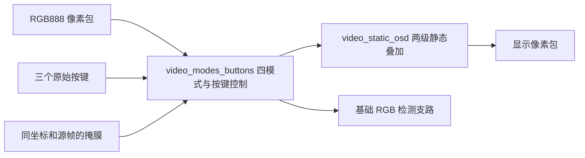

# B7 交接单

当前交付范围为按键控制四模式视频和静态 OSD。功能顶层为 `rtl/video_display.v`，加入硬件工程的文件列在根目录 `rtl_sources.f`。不要把 `sim/` 下的 testbench 或独立综合探针顶层当作 HDMI 顶层。

## 数据通路

OSD 使用对应像素携带的 `in_mode`，不能接按键的 `requested_mode`。掩膜需要与 RGB 同源帧、同坐标；当前仿真使用棋盘测试掩膜。检测支路不叠加 Logo 和文字。

## 整机接入待办

1. 团队确认 RGB888 接入点、时钟和复位域、坐标/帧标记、源帧号与掩膜对齐，冻结接口版本。
2. 按实际时钟和按键极性设置消抖参数，将输出接到已有 HDMI 光栅时序。ISP 的 96 位四像素流须明确适配，不能简单截成 24 位。
3. 在实际板级工程完成综合、布局布线、时序检查，生成烧录文件。
4. 板上依次检查模式切换、Logo/标签/十字、连续运行及复位恢复，保留版本和现场证据。

下一开发阶段 B8 才增加动态目标框、坐标、状态和帧边界结果包更新。当前无动态目标显示、真实识别效果或整机上板结论。仓库材料用于团队复跑和审核，正式验收仍由团队确认。
