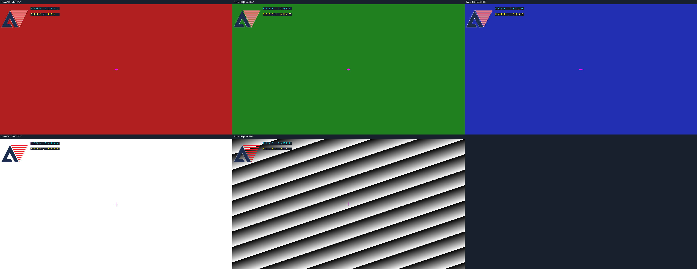

# 验证范围

本版从已验证的 `B7_review_20261006_165053` 整理而来，只调整目录、工具发现、脚本取文件路径和文档。16 个自编写功能 RTL、3 个 testbench、4 个参考模型及官方素材均保持原字节；哈希映射见 [migration.json](../reports/migration.json)。顶层功能清单包含两份素材 RTL，共 18 个文件。

## 原 B7 功能证据

| 检查 | 原运行 | 结果 |
|---|---|---|
| 素材读回 | run_20261006_122700_809890 | 32768 Logo 地址、4096 字模行，差异 0 |
| 独立 OSD 小图 | run_20261006_140339_066158 | 5 组布局/时序，每组五帧，差异 0 |
| 独立 OSD 720p | run_20261006_164025_847959 | 五种背景共 4608000 像素，差异 0 |
| 联合小图 | run_20261006_141704_824166 | normal、continuous、disabled，差异 0 |
| 联合 720p | run_20261006_160609_638188 | 十帧共 9216000 像素，差异 0 |
| 联合综合 | run_20261006_162810_943601 | 严格 75 MHz 检查通过 |

汇总、编译/仿真/比较日志及综合报告集中在 [reports/baseline](../reports/baseline/)。为减少散落文件，只保留两张预览，全部逐帧 PNG、CSV、波形、编译库与数据库可通过脚本重建。历史文本证据中的原工作区绝对路径替换为 `<original-workspace>`；它们属于历史运行，脚本哈希可能与重排后的脚本不同。

## 当前目录整理的验证

本次从其他工作目录调用新入口，验证不依赖调用位置。实际复跑结果由 [reports/layout_verification.json](../reports/layout_verification.json) 记录，包含素材读回、独立及联合小图、检查器自检与综合状态。原版 720p 证据与本版的 RTL、testbench、参考模型字节相同；本次目录整理不重复完整 720p，不能把原脚本的大图日志称作新入口的大图复跑。

模块仿真、综合检查、整机集成与上板验收是不同状态。本仓库尚未完成 HDMI 主工程接入、真实识别掩膜、布局布线、板级时序或 bit 文件生成。测试中的按键去抖阈值缩短为 4；综合保留默认 750000 周期计数器，未声称默认阈值完整长时功能测试通过。
