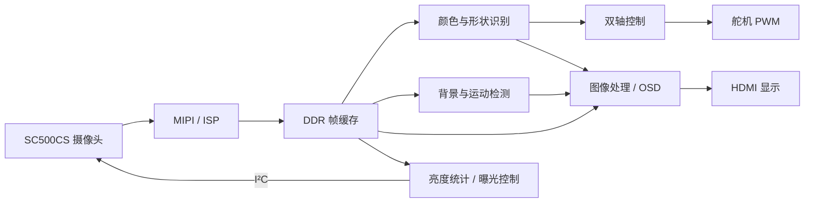

# 基于 FPGA 的双轴视觉跟踪云台

**2026 FPGA 创新设计赛道 · 安路赛道 · 选题二**  
基于安路 PH1P35 的实时数字图像处理系统  
参赛成员：华尔涵、张韶珍、张梓琪

以 HX1P35A 开发板为核心，连接 SC500CS 摄像头和双轴舵机云台。FPGA 完成视频采集、图像处理、目标识别、控制与显示，形成从视觉输入到云台动作的完整链路。当前提交版本为 **F3A**。

**[下载源码与 bit](https://github.com/erhanerrrrr/anlogic-fpga-vision-gimbal/releases/latest)** · **[系统设计](docs/ARCHITECTURE.md)** · **[编译与仿真](docs/BUILD.md)** · **[板端操作](docs/OPERATION.md)** · **[验证结果](docs/VALIDATION.md)**

## 功能概览

| 功能 | 项目实现 |
| --- | --- |
| 视频采集与显示 | MIPI 摄像头输入、DDR 帧缓存、1280×720 HDMI 输出 |
| 图像处理 | 原始画面、灰度、二值化、边缘、颜色掩模、色阶简化等显示模式 |
| 目标识别 | 红、绿、蓝目标选择；卡片状、近圆形和不规则轮廓分类；识别框与类别叠加 |
| 双轴跟踪 | 根据目标偏差控制水平和俯仰舵机，支持中心保持、限速限幅、遮挡保持与视野内恢复 |
| 运动检测 | K3 采集空背景，区分空背景、运动前景和静止前景；黄色前景框与板载声光提示 |
| 自动曝光 | 根据亮度与高光统计调节摄像头曝光时间和模拟增益 |
| 延迟可视化 | 显示 CSI 帧起始至 HDMI TX 输入的当前、最小、最大延迟与趋势 |
| 信息与交互 | 安路 Logo、中心标记、数码管、双色灯、蜂鸣器、按键拨码及 UART 遥测 |

默认演示页保留画面、Logo、中心和识别框；详细参数与延迟图表通过按键切换查看。颜色识别、MOTION、自动曝光和延迟显示集成于同一个 bit。

## 系统结构



## 查看代码

| 入口 | 内容 |
| --- | --- |
| [`src/top/design_top_wrapper.v`](src/top/design_top_wrapper.v) | 系统顶层、模块连接与最终参数 |
| [`src/vision/`](src/vision/) | 颜色分割、区域定位、形状分类、颜色标定 |
| [`src/control/`](src/control/) | 跟踪控制、限幅与 PWM |
| [`src/motion/`](src/motion/) | 背景采集及运动检测 |
| [`src/exposure/`](src/exposure/) / [`src/timing/`](src/timing/) | 自动曝光 / 帧标记及延迟统计 |
| [`src/display/`](src/display/) / [`src/io/`](src/io/) | 图像与叠加显示 / 按键及板载外设 |
| [`platform/`](platform/) / [`constraints/`](constraints/) | 配套接口与 IP / 引脚和时序约束 |
| [`project/`](project/) / [`tb/`](tb/) / [`tools/`](tools/) | 工程文件 / 仿真用例 / 构建与记录工具 |

历史分工与开发版本集中保存在 [`archive/development/`](archive/development/)，不参与 F3A 编译。各阶段提交与作者记录保留，版本关系见[开发记录](docs/history/README.md)。

## 快速复现

器件为 **PH1P35MDG324，速度等级 -3**；发布版本使用 **TangDynasty 6.2.1 Engineer（6.2.168.116）**。辅助脚本使用 Python 3.10 或更高版本。

```shell
git clone https://github.com/erhanerrrrr/anlogic-fpga-vision-gimbal.git
cd anlogic-fpga-vision-gimbal
python tools/project.py check
python tools/project.py prepare
```

使用 TangDynasty 打开最后一条命令打印的 `.al` 工程，顶层为 `design_top_wrapper`。需要仿真时，将 Icarus Verilog 的 `iverilog` 和 `vvp` 加入 PATH，再运行：

```shell
python tools/run_tests.py
```

依赖检查、仿真和编译入口均在根目录；无需读取历史分支或修改本机绝对路径。完整操作见[编译说明](docs/BUILD.md)。

## 实现与验证

整理后的源码通过 30 项 HDL 回归、UART 解码检查和完整顶层综合；源代码与 F3A 构建快照核对一致。以下为 **F3A bit 原构建的最终布线结果**：

| Slice | ERAM | DSP | Setup WNS | Hold WNS |
| --- | --- | --- | --- | --- |
| 18716 / 21216 | 98 / 108 | 18 / 40 | +0.103 ns | +0.020 ns |

功能测试反馈和工具检查分别列于[验证结果](docs/VALIDATION.md)。延迟统计不包含显示器响应与舵机运动时间；时序分析仍有摄像头配置分频时钟及部分外部接口覆盖缺口。当前未据此宣称全接口时序签核或长期运行指标。

## 配置文件与来源

配置文件：[`release/F3A_demo_overlay.bit`](release/F3A_demo_overlay.bit)。本次仓库整理保持原 bit 和算法参数，SHA-256 为：

```text
bb8485f592b80be51f362e5254c6d1b841f965d23bfc843b12a9e081fae926c6
```

工程使用开发板配套接口及厂商 IP，原作者和版权说明保留，详见[来源与依赖](THIRD_PARTY.md)。正式参赛技术文档和演示成片将以确认后的文件补充；本页已提供代码审阅、编译和板端操作所需说明。
