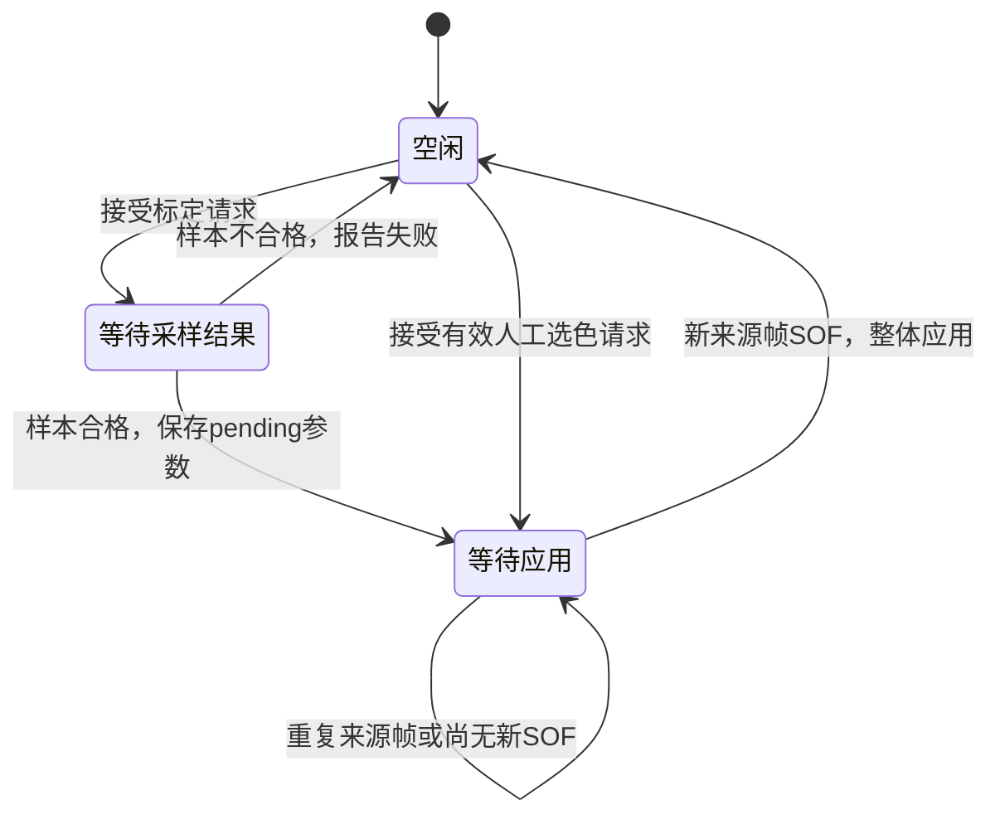

# C9：颜色标定、生成阈值和按帧生效

日期：2026-10-06；接口 c9-draft-1。完成本机仿真和TD综合；A/B公共接口确认及H3真实摄像头验收待完成。

## 用简单的话说

把想跟踪的色卡放进画面中央16×16小框，再发一次标定请求。系统收集下一张新画面的小框像素，判断颜色是否够明显、亮度是否合适、区域是否足够均匀。合格就算出新的颜色阈值，在之后的一张新来源帧开始时整体生效；不合格就报告原因，继续使用原阈值。

用户通过放置色卡并主动请求标定，指定要跟踪的颜色。成功标定得到的红/绿/蓝主色也随阈值一起生效。另提供人工选择红、绿、蓝的请求接口；人工选色恢复该颜色的默认80/40/40阈值，之后可以重新标定。本版只有一套活动参数，不保存三套独立标定记录。

## 数学规则

C8固定256个样本的通道均值取`sum >> 8`，向下取整。选择均值最大的通道D为主通道，红/绿/蓝编码分别为0/1/2；相等时先取红、再绿，但不明显的主色仍会被差值门槛拒绝。

依次检查，先失败的检查决定原因码：

| 原因码 | 检查 / 含义 |
|---:|---|
| 0 | 成功 |
| 1 | 采样未成功或count不等于256；细分中断原因另看C8的sample_reason |
| 2 | 统计不一致：任一通道不满足min≤mean≤max |
| 3 | 主通道均值不在80..224内；两端包含 |
| 4 | 任一通道max−min超过32；恰好32允许 |
| 5 | 主通道比另两通道的均值分别至少高40的条件未满足；恰好40允许 |

通过后生成：`min_main=meanD−32`，`diff_1=meanD−meanOther1−32`，`diff_2=meanD−meanOther2−32`。所有结果限幅到0..255。有符号差值先扩位，减32再用11位中间值限幅，避免负数回绕。

| 主色 | other1 / other2 | 比较规则 |
|---|---|---|
| 红 | 绿 / 蓝 | R≥min_main且R−G≥diff_1且R−B≥diff_2 |
| 绿 | 红 / 蓝 | G≥min_main且G−R≥diff_1且G−B≥diff_2 |
| 蓝 | 红 / 绿 | B≥min_main且B−R≥diff_1且B−G≥diff_2 |

有效样本实际生成的主通道下限在48..192，差值下限在8..192；正常有效样本不触发限幅。限幅核另对全部1024个10位有符号输入值测试，覆盖小于0和超过255的情况。

验收样例的均值(152,40,40)、极值(144..160,40,40)生成红色120/80/80。像素(130,50,50)通过，(130,51,50)和(119,39,39)失败，(120,40,40)恰好通过。纯绿(40,152,40)和纯蓝(40,40,152)分别生成相同数值的绿/蓝规则。

## 状态与帧边界



“等待采样结果”包含C8等待下一新帧及采集ROI的过程。C8采样输出在输入EOF边沿后锁存；C9在下一拍生成完成事件并存入pending。在这同一拍恰好开始的新帧仍使用旧参数；只有pending在边沿之前已准备好的后续新来源帧才能应用。

应用同时更新主色、三个阈值及`active_cfg_id`。分类器在应用边沿使用pending值处理该帧的首像素，避免首像素仍用旧值。参数在整帧内固定，检测结果及滤波掩膜携带各自帧的版本号；较晚输出的前一帧结果仍带旧版本。

来源帧号只按相邻SOF是否相等判断新旧，最大值回绕到0是新帧。重复显示旧来源帧不能提交pending。参数版本号为16位，从0开始，每次实际应用加1，65535之后回到0；不是时间戳，也不支持无限历史去重。

## A/B接入接口

完整新顶层为`rtl/recognition/rgb_calibrated_result.v`。输入RGB、坐标、标记、来源帧号沿用公共流接口；C9自行管理主色与参数版本，不再由外部输入`cfg_id/active_color`。A/B应使用新输出字段接入，不能把新顶层直接按旧位置端口替换。

| 字段 | 使用方式 |
|---|---|
| calibrate_req | 同像素时钟域单拍请求；闲时接受，驱动C8采样 |
| color_select_req / color_select[1:0] | 人工选色单拍请求；0红、1绿、2蓝；3非法 |
| busy | 从接受操作起，到失败或新参数实际应用前一直为1，包含等待帧、采样、计算、等待应用 |
| request_ignored / ignored_requests[15:0] | 忙碌标定请求被忽略的单拍事件 / 饱和累计计数，复位清0 |
| select_ignored | 忙碌、非法选色，或与标定请求同拍而被忽略的事件 |
| calibration_done / calibration_ok | 本次标定计算完成事件 / 是否生成合格参数；成功此时只是已准备好 |
| calibration_reason / calibration_frame_id | 最近一次标定计算的原因及实际采样来源帧号 |
| pending_valid、pending_color/main/diff_1/diff_2 | 等待提交的整套参数；valid为0时保留的字段只供调试 |
| cfg_applied | 新参数在新SOF实际应用的单拍事件；人工选色也产生此事件 |
| active_cfg_id、active_color/main/diff_1/diff_2 | 已实际生效的版本及参数 |
| sample_*、sum/min/max/mean_* | 保留C8采样统计，便于失败诊断 |
| filtered_*、result_*及目标/调试字段 | 沿用C7语义，标签使用产生该帧时的参数版本 |

同时出现标定和选色请求，标定优先；忙碌时额外请求忽略而不排队，完成或应用同拍的请求也按忙碌处理，下一拍才可接受。C9首版明确采用这个规则；S0早期选色草案的“重复请求取最后有效值”未在此版实现，A/B冻结交互接口时应以此处行为为准。

原始按键需要上游同步和消抖。请求应为单拍；持续拉高会被按每拍一个请求处理。`calibration_ok`等结果字段保持到下次完成或复位，读取新事件要看strobe，不能仅看保持的成功位。

低有效异步复位清空请求和pending，恢复红色80/40/40、cfg_id=0，并丢弃半帧；集成时同步释放复位。采样停帧或准备好后没有新帧时，保持busy，不会伪造成功或强行应用。超时提示及恢复操作由上游负责，本步没有自动超时或取消命令。

## 实际整链测试

720p连续五帧，使用(100,0,0)作为切换探针，采样帧的小框改为验收红样本：

| 来源帧 | 参数版本 / 阈值 | 原始掩膜为1的点数 | 说明 |
|---|---|---:|---|
| 100 | 0 / 80,40,40 | 921600 | 帧中请求标定 |
| 101 | 0 / 80,40,40 | 921600 | 采集红色ROI |
| 102 | 0 / 80,40,40 | 921600 | SOF恰逢参数生成，整帧仍用旧值 |
| 102重复 | 0 / 80,40,40 | 921600 | 重复帧不应用、不增加检测通知 |
| 103 | 1 / 120,80,80 | 0 | 新SOF整体切换，整帧探针拒绝 |

五帧原始和滤波输出各4,608,000像素均逐像素检查。前三份新检测结果有效，面积917604、框(1,1)..(1278,718)，符合C5边界置零；帧103无目标，几何清0。重复102只重算显示掩膜。

64×48整链另外验证三次成功标定（红→绿→蓝）、灰/暗/白/混色拒判、人工恢复预设、非法选色、busy重复请求、采样停帧及复位、采样完成后计算前复位。所有原始掩膜像素、滤波像素、结果包、cfg标签和延迟与独立参考一致。半帧复位刻意丢弃剩余滤波像素，所以该组输入有效数100352、滤波有效数100221不相等；未把半帧当作完整输出验收。

独立算术/像素测试4118周期，含边界锚点、4096组固定种子统计和分类输入、全部限幅输入范围。独立控制器65563周期，覆盖生成与SOF同拍、来源帧号及cfg_id回绕、无效结果、请求竞争、复位和65535饱和计数。缺样本在C8采样回归和C9参数核中验证；本步未扩大合法像素流契约。

固定延迟：采样EOF到`calibration_done`为1拍；生成到应用需等下一符合条件的新SOF，没有固定帧数。RGB EOF到检测通知仍为W+7拍，即64宽71拍、1280宽1287拍。新标定不会改动旧帧流水线中的标签。上述为仿真周期，不是板上时序或帧率证明。

## 运行与证据

```powershell
python scripts/run_c9.py
python scripts/run_c9.py --check-only
python scripts/run_c9_td.py
```

`python scripts/run_c9.py --check-only --inject-error`故意把一个应通过像素改为不通过，必须退出1。独立临时目录复制必要源文件后重新编译仿真，正常退出0、错误自检退出1。C1–C8累计回归状态见验收记录。

- RTL：`calibration_params.v`、`saturate_sub32.v`、`calibration_control.v`、`color_classifier_runtime.v`、`rgb_calibrated_result.v`；C1–C8模块原文件未改。
- 参考与场景：`model/c9_reference.py`、`tests/fixtures/c9/cases.json`。
- 单核实际输出：`reports/c9/generated/params_actual.csv`和`control_actual.csv`。
- 每组活动版本/阈值：`configs.csv`；标定结果及pending：`calibrations.csv`；完整像素差异由TB逐点断言。
- 每组原始掩膜计数：`raw_counts.csv`；检测结果：`actual.csv`；独立期望：`expected_*.json`。
- 小尺寸波形：`reports/c9/generated/protocol/calibration_trace.vcd`。
- 汇总、复测、回归：`summary.json`、`clean_directory.log`、`regression.log`及`regressions/`。

ModelSim编译0错误/0警告，两个独立核仿真0错误/0警告。整链每组有4条已知端口提示：C8采样核的busy/request_ignored/ignored_requests未接出，顶层改由覆盖完整标定生命周期的C9控制器提供这些字段；不是缺少输入或未知值。

TD 6.2累计综合通过：1753 LUT、1524寄存器、2 ERAM20K、1 DSP、0锁存器，含513位可观察数据的分段读出测试外壳。比C8外壳报告增加311 LUT和91寄存器；比较受外壳与综合优化影响。110个逻辑IO未分配管脚的告警已知；未布局布线、未板级时序签核，测试外壳不可直接当成最终板级接口。

## 给 A 的 H3 实物步骤

1. 核实RGB输入顺序、固定白平衡后的接入位置、时钟复位及SOF/EOF语义。检测和采样必须使用同一份RGB。
2. B显示中央16×16框及busy、生成成功/失败、已应用版本。把选定色卡覆盖整个框，固定相机和光照，发一次标定请求。
3. 回传实际ROI的count、sum、min/max/mean、采样帧号、原因、pending参数，以及`cfg_applied`时的版本和来源帧号。
4. 合格时确认新框/目标结果携带新cfg_id；灰色、暗色、白色及框内混色应报告失败并保留原规则。实物效果以检测入口统计为准，手机拍屏RGB不能替代。
5. 红、绿、蓝分别测试，记录不同距离和照明下的误识别/漏识别；真实参数有效范围仍需现场证据。多张同色色卡的区分仍不在本版能力内。

下一步C10做C端整体验证和交付整理，尚未开始。
